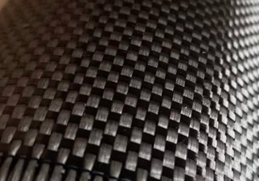
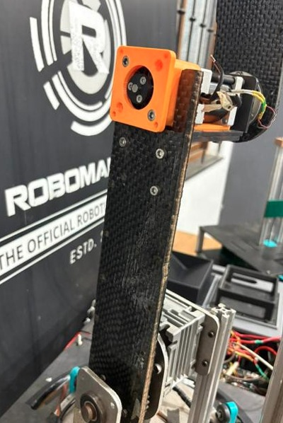
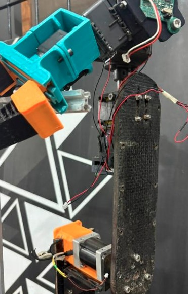

# Carbon Fiber Links

The Karma robot utilizes custom carbon fibre composite links to replace legacy aluminium structural components. This transition maximizes the structural strength-to-weight ratio, directly reducing rotational inertia and parasitic load on the arm's joint actuators while maintaining kinematic rigidity.

---

## 1. Overview & Objectives

* **Primary Objective:** Reduce overall manipulator mass and actuator holding torque requirements.
* **Material Strategy:** Implement a sandwich composite structure utilizing a lightweight wooden core enveloped in multi-axial carbon fibre laminates.
* **Fabrication Method:** Hand lay-up, chosen for rapid in-house prototyping and geometric adaptability without requiring high-temperature autoclaves.

---

## 2. Technical Specifications & Bill of Materials (BOM)

| Parameter | Specification | Notes / Configuration |
| :--- | :--- | :--- |
| **Fibre Material** | Standard Modulus Carbon Fibre | 400 GSM and 200 GSM |
| **Weave Pattern** | Plain Weave | Alternating over/under; highest stability |
| **Matrix Material** | 2-Part Epoxy Resin | Applied with standard release agent |
| **Core Material** | Wooden Core | Shaped manually for structural backing |
| **First Link (DOF 2-3)** | 3-3 Laminate | 400-200-400 GSM sequence (both sides) |
| **Second Link (DOF 3-4)** | 2-2 Laminate | 400 GSM (2 layers on both sides) |
| **Cure Time** | 24 Hours | Ambient temperature cure |

:::{note}
Fabrication requires the application of a liquid release agent on the tooling/moulding surfaces prior to epoxy application to prevent permanent adhesion.
:::

---

## 3. Design & Architecture

### Laminate Configuration
The structural integrity relies on the composite skin carrying the bending stresses while the wooden core handles shear loads and maintains cross-sectional spacing. 

* **Carbon Fibre Weave:** The laminate utilizes a Plain Weave pattern, where each fibre passes alternately over and under another fibre. This provides the simplest and most mechanically stable weave structure for handling multi-directional loads.
* **First Link (2nd & 3rd DOF):** Designed to handle heavy proximal joint loads, this link utilizes a hybrid 3-3 lay-up configuration. Sandwiching a 200 GSM layer between two 400 GSM layers (400–200–400 GSM) on each side of the wooden core provides optimal flexural stiffness and load-bearing capacity.
* **Second Link (3rd & 4th DOF):** Designed for the distal section of the arm, this link utilizes a symmetric 2-2 lay-up configuration. Fabricated using 2 layers of 400 GSM carbon fibre on each side of the wooden core, it minimizes mass at the end-effector while providing sufficient rigidity.


*Figure 1: Close-up macro view of the 400 GSM plain weave carbon fiber laminate.*

### Mathematical Model
The theoretical rule of mixtures was used to approximate the composite skin's elastic modulus ($E_c$) prior to layup:
$$
E_c = E_f V_f + E_m (1 - V_f)
$$
Where $E_f$ is the fibre modulus, $E_m$ is the matrix modulus, and $V_f$ is the fibre volume fraction. 

For the composite link's bending stiffness ($EI$), the sandwich panel approximation applies:
$$
EI \approx \frac{E_f \cdot b \cdot t_f \cdot d^2}{2}
$$
*(Where $b$ is link width, $t_f$ is total face sheet thickness, and $d$ is the distance between the centroids of the two carbon fibre skins).*

::::{grid} 2
:::{grid-item}

*Figure 2: Composite link secured to the joint 2 actuator mounting bracket.*
:::
:::{grid-item}

*Figure 3: Full robotic arm assembly highlighting the 3-3 sandwich carbon fiber link.*
:::
::::

---

## 4. Software/Hardware Interface

While the links themselves are passive mechanical structures, their reduced mass directly impacts the robot's kinematic models and control software. The URDF (Unified Robot Description Format) parameters must be updated to reflect the new dynamic properties to ensure the PID controllers do not overcompensate.

### URDF Mass & Inertia Update
```xml
<!-- Updated inertial properties for the 2nd-3rd DOF Composite Link -->
<link name="link_2_3">
  <inertial>
    <!-- Mass reduced by approx 40% compared to aluminium -->
    <mass value="0.285"/> 
    <origin xyz="0 0 0.15" rpy="0 0 0"/>
    <inertia 
      ixx="0.0012" ixy="0.0" ixz="0.0" 
      iyy="0.0012" iyz="0.0" 
      izz="0.00015"/>
  </inertial>
  <visual>
    <geometry>
      <mesh filename="package://karma_description/meshes/link_2_3_cf.stl"/>
    </geometry>
    <material name="carbon_fibre_black"/>
  </visual>
</link>
```
