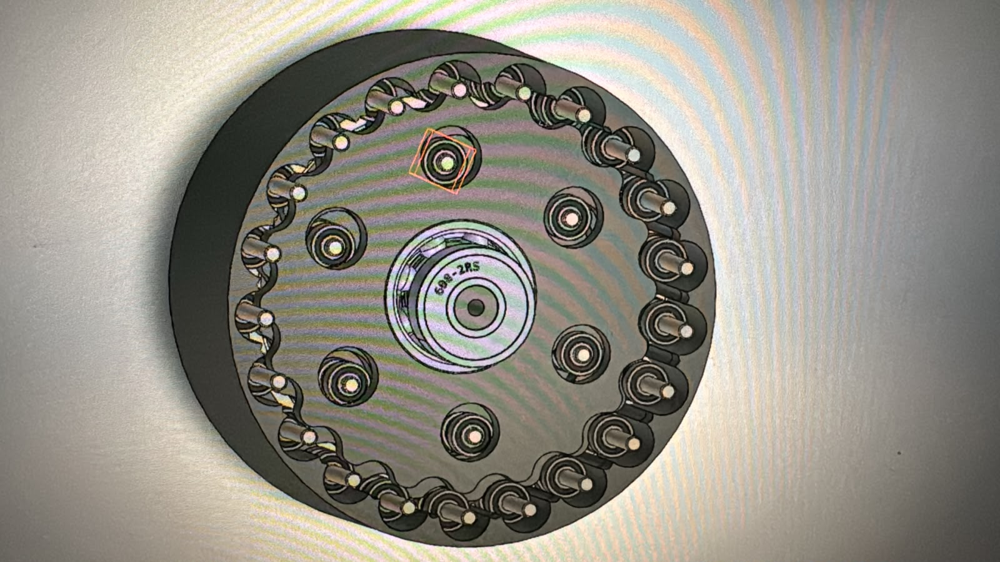
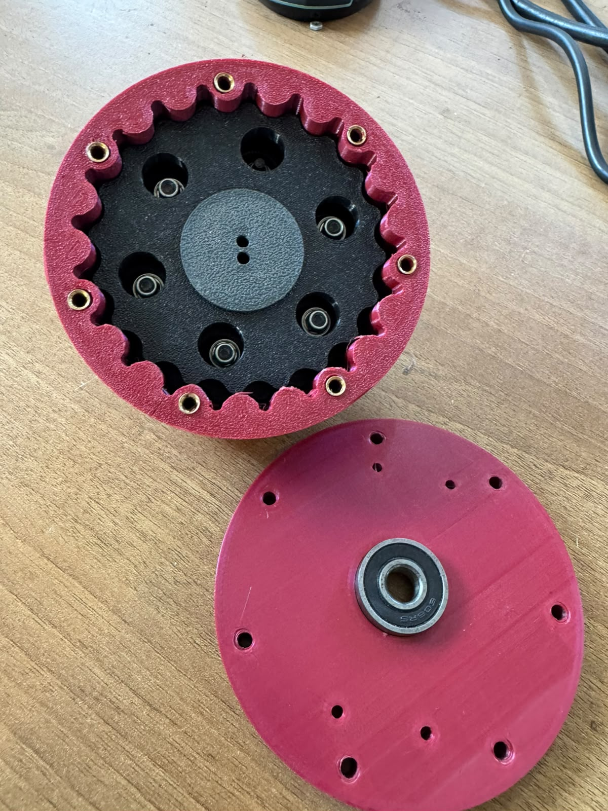
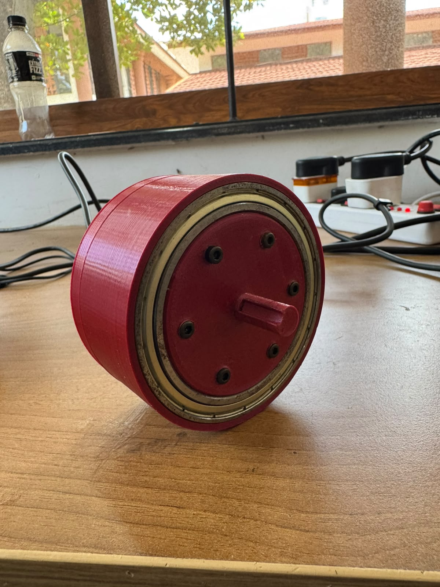

# Cycloidal Gearbox

This module documents the design iteration of the 20:1 cycloidal gearbox designed for the RoboManipal RoboCup SML 2026 robotic arm. The design utilizes the external housing as the rotational output and is currently optimized for NEMA 17 stepper motors, providing zero-backlash high-torque reduction. 

---

## 1. Overview & Objectives

The cycloidal gearbox functions as the primary torque multiplier for the robotic arm's joint actuation. The current iteration focuses on minimizing the dimensional footprint while maintaining smooth operation with 3D-printed (PLA) internal components. The design iteration reduced the outer diameter from 110 mm to 90 mm and overall thickness from 70 mm to 44 mm to improve the joint's volumetric efficiency.

---

## 2. Technical Specifications & Bill of Materials (BOM)

| Parameter / Component | Specification | Notes |
| :--- | :--- | :--- |
| **Gear Ratio** | 20:1 | Single-stage reduction |
| **Outer Diameter** | 90 mm | Iterated down from 110 mm |
| **Total Thickness** | 44 mm | Iterated down from 70 mm; shaft-dependent |
| **Input Shaft Diameter**| 8 mm | Requires coupling for NEMA 17 shafts |
| **Eccentricity ($e$)** | 1.5 mm | Cam shaft offset |
| **Cycloid Disc Thickness**| 5 mm | Occupies 8 mm axially due to bearing width |
| **Output Bearing** | 6813Z | Supports the housing (output) |
| **Eccentric Shaft Bearing**| 6008 | Drives the cycloidal disc |
| **Housing Rollers** | 8 mm | 3D printed directly into the housing |
| **Fixed Plate Rollers** | 3 mm ID / 8 mm OD | Mounted on 3 mm shoulder bolts |
| **Material** | PLA | Used for primary structural components |

---

## 3. Design & Architecture

The architecture inverts standard cycloidal drive outputs by fixing the central plate and utilizing the outer housing as the output member. The 8 mm rollers are integrated directly into the printed housing, while the fixed plate utilizes mechanical bearings on shoulder bolts to act as stationary pins.

### Kinematic Constraints
The transmission relies on the cycloidal disc profile driven by the eccentric shaft. The eccentricity offset dictates the radial displacement of the disc.
The relationship between the number of housing rollers ($N_r$), the lobes on the cycloid disc ($N_l$), and the reduction ratio ($R$) is defined by:
$$
R = \frac{N_l}{N_r - N_l}
$$
Given the 20:1 ratio and an eccentricity of $e = 1.5\text{ mm}$, the mechanical clearance is tightly constrained by the 5 mm disc thickness against the 8 mm bearing width.

:::{note}
The current cycloid disc occupies an effective 8 mm of axial space because of the bearing thickness, resulting in a 3 mm dead volume that can be eliminated in future iterations if thinner bearings are sourced.
:::

:::{warning}
PLA components exhibit smooth operation under current testing, but peak stall torque from the NEMA 17 motor risks shearing the printed 8 mm housing rollers under shock loads.
:::

::::{grid} 2
:::{grid-item}

*Figure 1: CAD top view of the 20:1 cycloid lobes, internal rollers, and eccentric drive.*
:::
:::{grid-item}

*Figure 2: Physical internal assembly showing internal roller bearings and 3D printed cycloid disc.*
:::
::::


*Figure 3: Fully assembled 3D printed 20:1 cycloidal gearbox with output shaft.*

---

## 4. Software/Hardware Interface

### Hardware Coupling
The primary hardware interface challenge is adapting the standard NEMA 17 output shaft (typically 5 mm) to the required 8 mm input shaft of the eccentric cam. 

### Joint State Publishing
To integrate the mechanical reduction into the ROS 2 control stack, the joint state publisher must account for the 20:1 hardware reduction when reading motor encoder ticks.

```yaml
# ROS 2 Joint Configuration for Cycloidal Output
arm_joint_actuator:
  ros__parameters:
    motor_type: "NEMA17"
    hardware_reduction_ratio: 20.0
    encoder_cpr: 3200
    output_topic: "/arm/joint_states"
```

---

## 5. Future Work / Known Limitations

Current testing has identified the following manufacturing and design bottlenecks that will be addressed in the next DFM revision:

* **Tolerancing:** Variations in 3D printing tolerances significantly affect the meshing between the printed 8 mm housing rollers and the cycloid disc. 
* **Material Upgrades:** Future iterations will replace the printed housing rollers with metal rollers to increase shear strength and wear resistance.
* **Size Reduction:** The 90 mm diameter will be further reduced by swapping the large-diameter ball bearings (6813Z and 6008) for low-profile brass or PTFE bushings.
* **Shaft Reinforcement:** Manufacturing a solid metal cam shaft is required to prevent deflection at the 1.5 mm eccentric offset.
* **Motor Coupling:** A custom rigid coupling must be machined to adapt standard motor shafts to the 8 mm gearbox input shaft efficiently.
