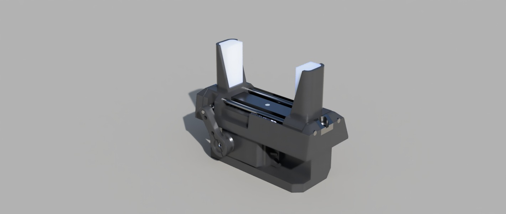

# Gripper Mechanism

The gripper module is a rack-and-pinion actuated end-effector designed for the RoboCup SML robot arm. It utilizes custom TPU-lined jaws to conform to rigid targets like Lego pieces, ensuring stable manipulation and payload securement during pick-and-place routines.

## 1. Overview & Objectives

* **Actuation:** Rack and pinion mechanism driven by a single rotary servo.
* **Grip Strategy:** Inner patterned TPU layers on the gripper jaws deform around the target geometry to increase contact area and grip stability.
* **Target Payload:** Irregularly shaped, low-weight objects (e.g., Lego blocks).

## 2. Technical Specifications & BOM

| Parameter | Specification | Notes |
| :--- | :--- | :--- |
| **Operating Voltage** | 4.8V – 7.2V DC | Standard servo voltage range |
| **Actuator** | MG995 Servo | Rack and pinion drive |
| **Rated Torque** | 15 kg-cm | **25 kg-cm** is recommended for this design |
| **Overall Width** | 94 mm | Full assembly width |
| **Overall Height** | 77 mm | Bottom of base to top of jaws |
| **Max Jaw Opening**| 55 mm | Maximum gap between TPU surfaces |
| **Total Weight** | ~150 g | Fully assembled |

**Bill of Materials (BOM):**
* 1x Base
* 1x MG995 Servo
* 1x Servo Head
* 1x Carriage
* 1x Center Bar
* 2x Carriage Rods
* 2x Gripper Jaws
* 2x TPU Gripper Jaw Inserts
* 1x Pinion Gear
* 1x Gear Rod

## 3. Design & Architecture

*Figure 1: Isometric CAD render of the rack-and-pinion gripper assembly.*

:::{warning}
The current MG995 servo supplies 15 kg-cm of torque, which falls short of the 25 kg-cm torque recommended for optimal performance with this mechanical design. Upgrading the actuator is advised to ensure grip reliability under load.
:::

## 4. Software/Hardware Interface

*(Omitted for this iteration)*

## 5. Future Work / Known Limitations

* **Issue:** High internal friction in the assembly leads to unsmooth actuation.
  * **Proposed Fix:** Modify mechanical tolerances on the carriage rods and pinion gear to reduce binding, and verify that the gear rod path is free of obstructions.
