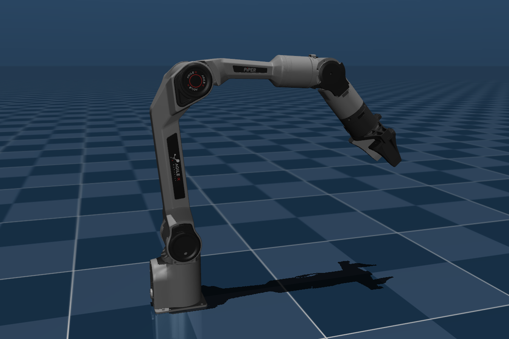
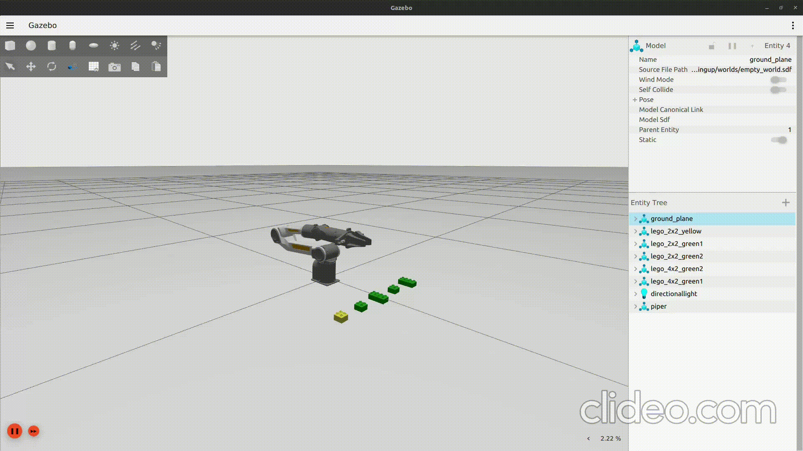

# Workbench Arm (AgileX Piper)

## Overview
The AgileX Piper Workbench Manipulation Module integrates a 6-Axis AgileX Piper robotic arm onto the workbench station. Designed for RoboCup SML 2026 workstation tasks, it is capable of executing trajectory generation, collision-aware motion planning, and autonomous pick-and-place routines. It integrates MoveIt 2 and MoveIt Task Constructor (MTC) to perform assembling and disassembling tasks of LEGO Duplo Bricks.



## Objectives

* Perform basic object manipulation tasks.
* Generate collision-free manipulation trajectories between `base_link`, onboard material containers, and workstation surface frames using MoveIt Task Constructor (MTC).
* Assemble LEGO bricks to form Products and disassemble them for recycling.

---

## Design and Architecture

### Piper MoveIt Configuration

#### MoveIt 2 KDL Kinematic Solver

The Kinematics Solver used by MoveIt 2 for this module is the Orocos Kinematics and Dynamics Library (KDL) numerical solver plugin (`kdl_kinematics_plugin/KDLKinematicsPlugin`). It resolves Inverse Kinematics (IK) queries to find joint angles for a commanded end-effector pose. KDL uses an iterative Newton-Raphson method combined with Damped Least Squares (DLS / Levenberg-Marquardt formulation) to avoid instabilities near kinematic singularities.

**KDL Solver Configuration (`kinematics.yaml`):**

```yaml
manipulator:
    kinematics_solver: kdl_kinematics_plugin/KDLKinematicsPlugin
    kinematics_solver_search_resolution: 0.005
    kinematics_solver_timeout: 0.05
```

| Parameter | Type | Default | Description |
| :--- | :---: | :---: | :--- |
| `kinematics_solver` | String | *Required* | C++ plugin class name for IK |
| `kinematics_solver_timeout` | Double | `0.005` | Maximum allowable runtime per call (seconds) |
| `kinematics_solver_attempts` | Integer | `3` | Number of random seed restarts on failure |
| `position_only_ik` | Boolean | `false` | Solves strictly for 3D position targets $(x, y, z)$ while ignoring end-effector orientation constraints |
| `solve_type` | String | `Speed` | `Speed`: Returns the first valid IK solution found. `Distance`: Evaluates multiple seeds and returns the solution closest in joint space. `Manipulability`: Selects the solution maximizing dexterity metric $w = \sqrt{\det(\mathbf{J}\mathbf{J}^T)}$ |

#### ROS 2 Control Framework
MoveIt 2 interfaces with the ROS 2 Control framework for trajectory execution. In the MoveIt configuration package, `ros2_controllers.yaml` configures the `controller_manager` and instantiates low-level hardware controllers. The framework hosts a `FollowJointTrajectory` action server that receives trajectories from MoveIt 2.

Planned joint trajectories are time-parameterized and streamed to low-level controllers, which manage joint-level actuation and feedback. This separation between planning and execution enables high-level autonomy while maintaining deterministic timing and safe control behavior.

**ROS 2 Controllers Configuration (`ros2_controllers.yaml`):**

```yaml
controller_manager:
  ros__parameters:
    update_rate: 100

    joint_state_broadcaster:
      type: joint_state_broadcaster/JointStateBroadcaster

    joint_trajectory_controller:
      type: joint_trajectory_controller/JointTrajectoryController

    gripper_controller:
      type: joint_trajectory_controller/JointTrajectoryController

joint_trajectory_controller:
  ros__parameters:
    joints:
      - joint_1
      - joint_2
      - joint_3
      - joint_4
      - joint_5
      - joint_6

    command_interfaces:
      - position

    state_interfaces:
      - position
      - velocity

    action_monitor_rate: 20.0

gripper_controller:
  ros__parameters:
    joints:
      - gripper_joint
      - mimic_gripper_joint

    command_interfaces:
      - position

    state_interfaces:
      - position
      - velocity

    action_monitor_rate: 20.0
```

A custom hardware interface manages the actuators of the robotic arm by presenting them as a single unified kinematic chain. Joint feedback is continuously published, enabling real-time monitoring and triggering replanning when environmental interactions occur.

#### OMPL Motion Planning Integration & Planner Configuration

For pick-and-place tasks and object manipulation, the Piper arm utilizes the Open Motion Planning Library (OMPL) as its core sampling-based planning backend via the `ompl_interface/OMPLPlanner` plugin. This pipeline maps the Piper arm's 6-DOF kinematic chain into configuration space (C-space) to generate collision-free joint trajectories.

The module utilizes `geometric::RRTConnect` as its primary OMPL solver. Its bi-directional tree expansion delivers fast, high-success path generation within the workbench environment.

---

## PickPlace Package

### MoveIt Task Constructor Workbench Pick-and-Place Pipeline

MoveIt Task Constructor decomposes complex manipulation tasks into a directed graph of simple, reusable sub-tasks called **Stages**. The planning scene maintains a real-time 3D representation of the robot and its surroundings, enabling collision-aware motion generation.



### Stage Breakdown

| # | Stage Name | MTC Class | Solver Used | Configuration & Parameters |
| :---: | :--- | :--- | :--- | :--- |
| **1** | `current` | `CurrentState` | *None* | Captures active planning scene joint positions and collision state. |
| **2** | `open hand` | `MoveTo` | `JointInterpolation` | Group: `gripper`, Target goal: `"open"`. |
| **3** | `move to pick` | `Connect` | `PipelinePlanner` | Group: `manipulator`, Timeout: `5.0 s`. |
| **4.1** | `generate grasp pose` | `GenerateGraspPose` <br>*(Wrapped in `ComputeIK`)* | *Sampler* / IK Solver | Target: `object_id`, Pre-grasp: `"open"`, $\Delta\theta = \frac{\pi}{2}$, Monitored stage: `current`, Max IK solutions: `8`, IK frame offset: $z = +0.05\text{ m}$, rotated $180^\circ$ on X axis relative to `tcp`. |
| **4.2** | `allow collisions` | `ModifyPlanningScene` | *None* | `allowCollisions(object_id, gripper_links, true)`. |
| **4.3** | `close hand` | `MoveTo` | `JointInterpolation` | Group: `gripper`, Target goal: `"closed"`. |
| **4.4** | `attach object` | `ModifyPlanningScene` | *None* | Binds `object_id` to frame `tcp`. |
| **4.5** | `lift object` | `MoveRelative` | `CartesianPath` | Group: `manipulator`, Direction: $+1.0\text{ m}$ along `base_link` $+Z$, Min/Max distance: $[0.05, 0.3]\text{ m}$. |
| **5** | `move to place` | `Connect` | `PipelinePlanner` | Group: `manipulator`, Timeout: `5.0 s`. |
| **6.1** | `allow collision between objects` | `ModifyPlanningScene` | *None* | `allowCollisions(object_id, addingcollisions, true)`. |
| **6.2** | `generate place pose` | `GeneratePlacePose` <br>*(Wrapped in `ComputeIK`)* | *Sampler* / IK Solver | Target pose: $(x, y, z)$ in `base_link`, Monitored stage: `attach object`, Max IK solutions: `8`, IK frame: `object_id`. |
| **6.3** | `Approach down` | `MoveRelative` | `CartesianPath` | Group: `manipulator`, Direction: $-1.0\text{ m}$ along `base_link` $-Z$, Min/Max distance: $[0.00, 0.002]\text{ m}$. |
| **6.4** | `open hand` | `MoveTo` | `JointInterpolation` | Group: `gripper`, Target goal: `"open"`. |
| **6.5** | `forbid collision (hand,object)` | `ModifyPlanningScene` | *None* | `allowCollisions(object_id, gripper_links, false)`. |
| **6.6** | `detach object` | `ModifyPlanningScene` | *None* | Unbinds `object_id` from frame `tcp`. |
| **6.7** | `disallow collisions` | `ModifyPlanningScene` | *None* | Restores collision checks between `addingcollisions` and `object_id`, keeps collisions enabled between `addingcollisions` and `gripper_links`. |
| **6.8** | `retreat` | `MoveRelative` | `CartesianPath` | Group: `manipulator`, Direction: $+0.1\text{ m}$ along `base_link` $+Z$, Min/Max distance: $[0.01, 0.3]\text{ m}$. |
| **7** | `return home` | `MoveTo` | `PipelinePlanner` | Group: `manipulator`, Target goal: `"forward"`. |
| **8** | `close` | `MoveTo` | `JointInterpolation` | Group: `gripper`, Target goal: `"closed"`. |

### Assembly Task

For assembly tasks, the package uses a YAML file to store sequences. At runtime, `mtc_node` loads a specific recipe based on the `object_name` ROS 2 parameter provided at launch. The `blocks` section initializes collision primitives and rest poses within MoveIt's Planning Scene to match the initial Gazebo world layout.


```yaml
traffic_light:
    blocks:
      block1: { dims: [0.0317, 0.0317, 0.024], x: 0.25, y: 0.1, z: 0.012 }
      block2: { dims: [0.0317, 0.0317, 0.024], x: 0.25, y: 0.0, z: 0.012 }
      block3: { dims: [0.0317, 0.0317, 0.024], x: 0.25, y: -0.1, z: 0.012 }
    steps:
      - { type: pick_place, object_id: "block2", place: [0.25, 0.1, 0.039], allow_collision_with: ["block1"] }
      - { type: weld, model1: "lego_2x2_green", link1: "g_link", model2: "lego_2x2_yellow", link2: "y_link" }
      - { type: attach, into: "block1", from: "block2" }
      - { type: pick_place, object_id: "block3", place: [0.25, 0.1, 0.063], allow_collision_with: ["block3", "block2", "block1"] }
      - { type: weld, model1: "lego_2x2_yellow", link1: "y_link", model2: "lego_2x2_red", link2: "r_link" }
      - { type: attach, into: "block1", from: "block3" }
      - { type: pick_place, object_id: "block3", place: [0.25, 0.0, 0.063], allow_collision_with: ["block3", "block2", "block1"] }
```

Operational `pick_place` steps execute MoveIt Task Constructor pipelines to move objects while explicitly controlling collision allowances with surrounding pieces. The `weld` step calls the Gazebo `/link_attacher/attach` service to physically join model links in the physics engine. In parallel, the `attach` step logically binds these shapes inside MoveIt's Planning Scene so attached objects move together as a single rigid body during future manipulations.

---

## Future Work / Known Limitations

### Known Limitations

* **Open-Loop Assembly:** The current placement pipeline relies entirely on open-loop geometric positioning and Gazebo service attachment. The system lacks Force/Torque (F/T) sensing and impedance control, making real-world physical mating of tight-fitting LEGO bricks prone to mechanical jams or placement failures caused by minor calibration offsets.
* **Static Grasp Generation:** The `GenerateGraspPose` stage in MTC uses pre-configured angular steps ($\Delta\theta$) and fixed Z-axis approach vectors. It cannot dynamically adapt to tipped, misaligned, or unmodeled objects.
* **Sub-Optimal Trajectories:** While `geometric::RRTConnect` rapidly solves high-DOF planning queries, it does not optimize for path length, smoothness, or joint wear. This can result in erratic or sweeping manipulator motions during task execution.
* **Deterministic Environment Assumption:** Planning assumes that the physical environment strictly mirrors the workspace model defined in YAML configurations. Dynamic obstacles or displaced bricks are not detected or avoided at runtime.

### Future Work

* **Perception Integration:** Mount a wrist-mounted or stationary RGB-D camera (e.g., Intel RealSense) to feed point clouds directly into MoveIt via OctoMap, enabling 6D pose estimation and dynamic object localization.
* **Trajectory Optimization:** Chain post-processing optimization algorithms (e.g., CHOMP, STOMP, or TrajOpt) downstream of the RRT-Connect planner to smooth joint trajectories and minimize execution time.
* **Compliant Control:** Implement admittance or impedance controllers in `ros2_control` to allow active compliance and tactile feedback during mechanical insertion of LEGO bricks.
* **Dynamic Grasp Synthesis:** Replace fixed-heuristic grasp generators with learning-based models (such as GraspNet or Dex-Net) to calculate optimal grasp poses for arbitrary geometric objects in real time.
