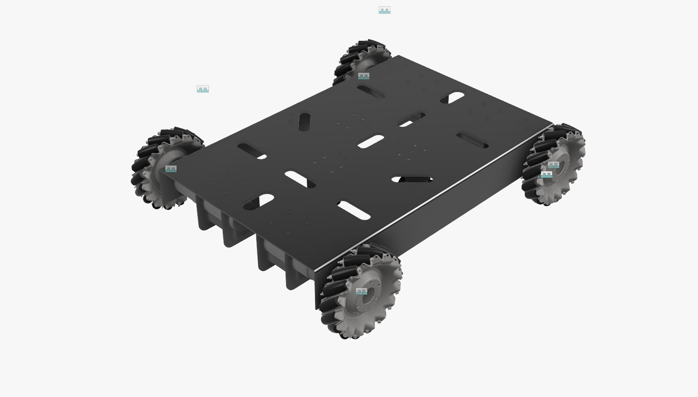

# Mecanum Drivetrain

The mobile base implements a 4-wheel holonomic Mecanum drive configured in an X-drive formation. It provides the robot with uniform, omnidirectional planar motion, allowing translation in any direction without requiring prior rotational reorientation.

---

## 1. Overview & Objectives

* **Holonomic Mobility:** Utilizes Mecanum wheels featuring a series of rollers aligned parallel to each other, but offset at exactly 45 degrees relative to the wheel's hub axis.
* **Vector Generation:** Produces arbitrary planar motion vectors ($v_x$, $v_y$, $\omega_z$) by modulating the independent RPM and rotational direction of each of the four wheels.
* **Direct Power Transmission:** Heavy-duty planetary geared motors are rigidly mated to the wheels via custom aluminium couplers to minimize backlash and ensure efficient torque transfer.

---

## 2. Technical Specifications & Bill of Materials (BOM)

| Component | Specification | Notes / Part Number |
| :--- | :--- | :--- |
| **Drive Motors (x4)** | 24V, 750 RPM, 100W | Rhino IG52 Extra Heavy Duty Planetary Geared DC motor; 10 kg·cm torque rating. |
| **Mecanum Wheels (x4)** | 152mm Diameter | Sourced from robu.in; configured for X-drive mounting (Left/Right variants). |
| **Shaft Couplers (x4)** | Machined Aluminium | Provides rigid coupling between the IG52 output shaft and the 152mm wheel hub. |
| **Drive Configuration** | Holonomic X-Drive | 4-wheel independent drive system for omnidirectional kinematics. |

---

## 3. Design & Architecture

### Kinematic Model

The robot controls its trajectory by calculating individual wheel angular velocities ($\omega_i$) based on the target base velocity in the $x$ (forward), $y$ (lateral), and $z$ (rotational) axes.

For an X-drive configuration, the inverse kinematics mapping the commanded chassis twist to individual wheel speeds is defined by the following matrix equation:

$$
\begin{bmatrix} \omega_1 \\ \omega_2 \\ \omega_3 \\ \omega_4 \end{bmatrix} = \frac{1}{r} \begin{bmatrix} 1 & -1 & -(l_x + l_y) \\ 1 & 1 & (l_x + l_y) \\ 1 & 1 & -(l_x + l_y) \\ 1 & -1 & (l_x + l_y) \end{bmatrix} \begin{bmatrix} v_x \\ v_y \\ \omega_z \end{bmatrix}
$$

Where:
* $r$ = Wheel radius (76 mm).
* $l_x$ = Half-distance between front and rear wheel axles.
* $l_y$ = Half-distance between left and right wheel planes.

:::{warning}
The 45-degree roller alignment dictates that opposite wheels (Front-Left/Rear-Right and Front-Right/Rear-Left) must be identical Mecanum variants to properly cancel out parasitic axial forces during pure forward translation.
:::

### Visual Reference


*Figure 1: Isometric CAD model of the 4-wheel Mecanum X-drive chassis assembly.*

---

## 4. Software/Hardware Interface

The drivetrain interfaces directly with the ROS 2 navigation stack, subscribing to standard velocity command messages and distributing target RPMs to the low-level motor controllers.

### ROS 2 Interface Definitions

* **Input Topic:** `/cmd_vel` (`geometry_msgs/msg/Twist`)
* **Output Topic:** `/odom` (`nav_msgs/msg/Odometry`)
* **Feedback Topic:** `/drive/joint_states` (`sensor_msgs/msg/JointState`)

### Control Implementation

```cpp
// Mobile Base Mecanum Kinematics Node (ROS 2)
#include "rclcpp/rclcpp.hpp"
#include "geometry_msgs/msg/twist.hpp"
#include "std_msgs/msg/float64_multi_array.hpp"

class MecanumDriveController : public rclcpp::Node {
public:
    MecanumDriveController() : Node("mecanum_drive_controller") {
        cmd_vel_sub_ = this->create_subscription<geometry_msgs::msg::Twist>(
            "/cmd_vel", 10, std::bind(&MecanumDriveController::twistCallback, this, std::placeholders::_1));
        wheel_cmd_pub_ = this->create_publisher<std_msgs::msg::Float64MultiArray>("/drive/wheel_cmds", 10);
        
        // Wheel geometry parameters (in meters)
        wheel_radius_ = 0.076; 
        lx_plus_ly_ = 0.35; 
    }

private:
    void twistCallback(const geometry_msgs::msg::Twist::SharedPtr msg) {
        std_msgs::msg::Float64MultiArray wheel_speeds;
        wheel_speeds.data.resize(4);
        
        double vx = msg->linear.x;
        double vy = msg->linear.y;
        double wz = msg->angular.z;

        // Kinematic translation to angular velocities (rad/s)
        wheel_speeds.data[0] = (vx - vy - wz * lx_plus_ly_) / wheel_radius_; // Front-Left
        wheel_speeds.data[1] = (vx + vy + wz * lx_plus_ly_) / wheel_radius_; // Front-Right
        wheel_speeds.data[2] = (vx + vy - wz * lx_plus_ly_) / wheel_radius_; // Rear-Left
        wheel_speeds.data[3] = (vx - vy + wz * lx_plus_ly_) / wheel_radius_; // Rear-Right

        wheel_cmd_pub_->publish(wheel_speeds);
    }

    rclcpp::Subscription<geometry_msgs::msg::Twist>::SharedPtr cmd_vel_sub_;
    rclcpp::Publisher<std_msgs::msg::Float64MultiArray>::SharedPtr wheel_cmd_pub_;
    double wheel_radius_;
    double lx_plus_ly_;
};
```

---

## 5. Future Work / Known Limitations

* **Roller Slippage:** Mecanum wheels are inherently prone to minor slippage on dusty or uneven planar surfaces. This introduces inaccuracies into open-loop kinematic odometry.
* **Suspension System:** The current rigid aluminium coupler design does not account for floor irregularities. Future iterations will require a suspension module to ensure all four 152mm wheels maintain constant ground contact.
* **Odometry Fusion:** Current dead-reckoning from the 750RPM motors needs to be fused with an IMU and dead-wheel odometry (via `robot_localization` EKF) to compensate for lateral roller slip during high-acceleration maneuvers.
