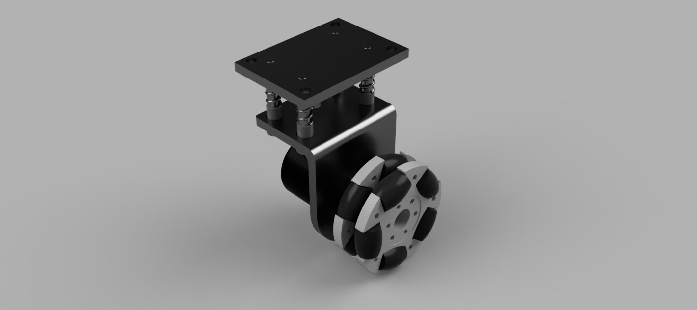

# Dead-Wheel Odometry Pods

This module documents the 3-wheel dead-wheel odometry suspension system designed for the RoboManipal RoboCup SML 2026 mobile base. The assembly mechanically decouples odometry tracking from the drive wheels to eliminate errors caused by mecanum wheel slip, utilizing a spring-loaded linear bearing mechanism to maintain continuous floor contact.

---

## 1. Overview & Objectives

The primary objective of this module is to provide accurate, slip-independent $X$, $Y$, and $\theta$ (rotational) tracking data. The design uses a custom suspension system to ensure three omni-directional dead wheels remain in contact with the ground across uneven terrain, compensating for the rigid nature of the primary mecanum drivetrain. 

---

## 2. Technical Specifications & Bill of Materials (BOM)

| Parameter / Component | Specification | Notes |
| :--- | :--- | :--- |
| **Drive Kinematics** | Mecanum | Isolates odometry tracking from drive slip |
| **Odometry Wheels** | 60 mm Omni Wheels | 3 units (1 X-axis, 2 Y-axis) |
| **Linear Bearings** | LM6UU | 12 units total (4 per wheel pod) |
| **Guide Shafts** | 60 mm Shoulder Bolts | 12 units total |
| **Suspension** | Coil Springs | 12 units mounted concentrically on bolts |
| **Structural Mounts** | Mild Steel | Custom laser-cut and bent sheet metal |

---

## 3. Design & Architecture

The odometry tracking relies on a 3-wheel planar configuration mounted directly to the main chassis via custom mild steel brackets.

### Kinematic Configuration
* **X-Axis Tracking:** One 60 mm omni wheel is mounted perpendicular to the forward vector to measure lateral translation.
* **Y-Axis & Rotational Tracking:** Two 60 mm omni wheels are mounted parallel to the forward vector. 
* **Differential Rotation:** Placing the two Y-axis wheels parallel to each other allows the system to calculate high-accuracy rotational odometry by measuring the differential travel between them.

The change in heading ($\Delta\theta$) is calculated using the distance traveled by the two parallel Y-axis wheels ($\Delta d_{y1}$ and $\Delta d_{y2}$) and the track width distance ($L$) between them:
$$
\Delta\theta = \frac{\Delta d_{y1} - \Delta d_{y2}}{L}
$$

### Suspension Architecture
Each wheel pod utilizes four 60 mm shoulder bolts acting as fixed guide rails. LM6UU linear bearings ride along these shafts, allowing the wheel carriage to translate vertically. Coil springs are inserted over the shoulder bolts between the carriage and the hard mount to provide continuous downward contact force.


*Figure 1: CAD render of the spring-loaded dead-wheel odometry pod and linear guide assembly.*

:::{warning}
The spring constant ($k$) of the currently installed springs is excessively high. This applies too much downward force, causing the dead wheels to lift the primary mecanum drive wheels off the ground, resulting in a loss of traction.
:::

---

## 4. Software/Hardware Interface

### Configuration Parameters
To interface the mechanical data with the ROS 2 navigation stack, the exact mechanical parameters must be loaded into the odometry node to convert encoder ticks into standard `nav_msgs/msg/Odometry` messages.

```yaml
# ROS 2 Dead-Wheel Odometry Configuration
dead_wheel_odom_node:
  ros__parameters:
    wheel_radius: 0.030          # 60 mm diameter wheels
    ticks_per_revolution: 4096   # Encoder resolution
    parallel_wheel_separation: 0.35  # L distance in meters
    publish_tf: true
    odom_frame: "odom"
    base_frame: "base_link"
```

---

## 5. Future Work / Known Limitations

Current testing and assembly have highlighted several mechanical and supply chain limitations that require addressing in the next iteration:

* **Spring Rate Optimization:** The downward force is currently too high. The springs must be replaced with units possessing a significantly lower spring constant to prevent chassis lift while maintaining reliable floor contact.
* **Component Sourcing:** Exact 60 mm shoulder bolts and correctly sized springs (specific free length and solid height) suffer from poor availability, necessitating design adjustments.
* **Mount Deflection:** The custom laser-cut and bent mild steel mounts currently experience bending under the spring load. 
  * **Proposed Fix:** Reinforce the mounts by integrating structural gussets at the bend lines, or redesign the suspension architecture to utilize a dual-wheel setup on a single mount to balance the moment loads.
